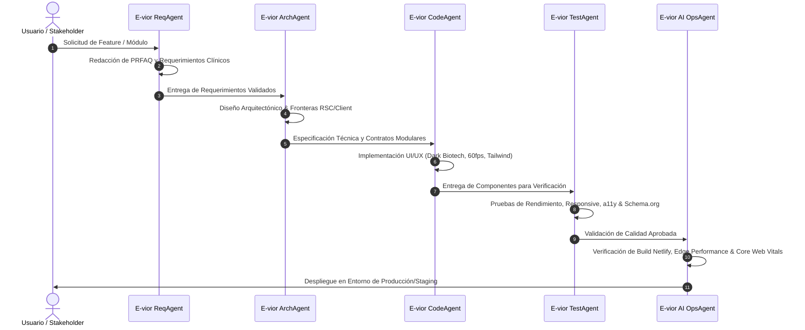

# OncoScan v0.0.1 — Root Orchestration (AGENTS.md)

> **E-vior Multi-Agent Orchestration & Project Governance**  
> Basado en el marco E-vior, principios NASA 17-Point Systems Engineering y Working Backwards.  
> Documento de Reglas del Sistema: [system_rules.md](file:///Users/emilianocastillo/OncoScan-v0.0.1/system_rules.md)

---

## 1. Mapeo de Personas y Responsabilidades

| Agente | Persona | Rol y Foco Operativo | Entregables Principales |
| :--- | :--- | :--- | :--- |
| **`E-vior ReqAgent`** | Requirements Engineer | NASA SE Pasos 1-2. Definición PRFAQ, especificaciones de usuarios clínicos/pacientes e inversionistas. | PRFAQ, Historias de Usuario, Requerimientos Clínicos. |
| **`E-vior ArchAgent`** | System Architect | NASA SE Pasos 3-4. Arquitectura Next.js App Router, límites RSC vs RCC, pipeline WebGL/Three.js. | Diagramas de Arquitectura, Contratos de Componentes, Árbol de Estado. |
| **`E-vior CodeAgent`** | Senior Frontend & Art Director | Implementación UI/UX (Apple × Ultrahuman × Neuralink), animaciones 60 FPS (Framer Motion/GSAP), Tailwind CSS. | Componentes modulares (<200 líneas), Estilos, Shaders, Hooks. |
| **`E-vior TestAgent`** | QA / SDET | NASA SE Pasos 7-8. Pruebas unitarias, pruebas E2E, auditorías de accesibilidad (a11y), validación Schema.org y SEO. | Test Suites, Reportes de Lighthouse, Validaciones JSON-LD. |
| **`E-vior AI OpsAgent`** | DevOps / SRE | NASA SE Paso 10. Pipeline de despliegue Netlify, Edge functions, Core Web Vitals, presupuestos de rendimiento y SLOs. | `netlify.toml`, Edge handlers, Monitoreo de SLOs. |
| **`E-vior Magentic`** | Orchestrator | Selección de patrones de interacción (Concurrent, Sequential, Chat) y sincronización de agentes. | Registro de tareas y planes de trabajo sincronizados. |

---

## 2. Flujo de Trabajo (NASA 17-Point & Working Backwards)

---

## 3. Enlace con Reglas de Entorno

Para directivas detalladas sobre estilo, estética Apple/Ultrahuman/Neuralink, optimización de tokens y directivas de SEO e internacionalización, consultar [system_rules.md](file:///Users/emilianocastillo/OncoScan-v0.0.1/system_rules.md).
