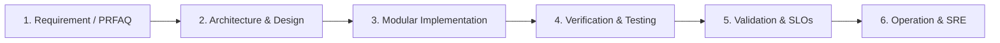

# OncoScan v0.0.1 — System Rules & Environment Specification

> **E-vior Multi-Agent Framework & Engineering Directives**  
> **Dominio:** DeepTech Biotech / Medical Device / Molecular Diagnostics  
> **Identidad:** Fusión Apple × Ultrahuman × Neuralink  
> **Última Actualización:** 2026-10-24  

---

## 1. Visión y Contexto del Proyecto

### 1.1 Perfil de OncoScan
**OncoScan** es una startup DeepTech de biotecnología enfocada en la **detección ultra-temprana y mínimamente invasiva del cáncer**. Su tecnología patentada integra tres pilares de frontera:
1. **Microfluidos de Precisión:** Manipulación física y separación molecular de fluidos biológicos a escala nanométrica.
2. **Biomarcadores Moleculares (microARN):** Detección y cuantificación de perfiles de expresión de microARN circulantes para el diagnóstico oncológico precoz.
3. **Inteligencia Artificial en Hardware Perimetral (Edge AI):** Redes neuronales ejecutadas localmente en microprocesadores dedicados dentro del dispositivo para análisis espectrométrico y diagnóstico en tiempo real sin latencia de nube.

### 1.2 Modelo de Negocio (B2B2C)
El sistema digital y comercial de OncoScan atiende tres audiencias críticas con una experiencia unificada:
- **B2B (Hospitales, Laboratorios y Centros Oncológicos):** Especificaciones técnicas rigurosas, validaciones clínicas, reproducibilidad y protocolos de integración hospitalaria.
- **Inversionistas Institucionales & DeepTech VCs:** Métricas de innovación, patentes de microfluidos, ventajas comparativas y roadmap biotecnológico.
- **B2C (Pacientes y Usuarios Finales):** Modelo **Freemium a Kit Físico** (Portal de biomarcadores digitales gratuito $\rightarrow$ adquisición del kit molecular doméstico de recolección y lectura diagnóstica).

### 1.3 Identidad de Marca y Tono
La presencia visual y técnica debe transmitir:
- **Precisión Clínica:** Máximo rigor médico, certificable y transparente, palabras y lenguaje simple y atractivo para usuarios. NO INVENTARAS INFORMACIÓN DE NINGÚN TIPO.
- **Tecnología de Frontera (DeepTech):** Ingeniería cuántica, microfluídica y computación perimetral avanzada.
- **Lujo y Sofisticación Científica:** Claridad estética, minimalismo y acabados de hardware premium.

---

## 2. Principios de Ingeniería y Gobernanza Global (E-vior Framework)

Todos los agentes y desarrolladores que operen en este entorno deben acatar de forma estricta los siguientes principios no negociables:



1. **NASA 17-Point Systems Engineering:**
   - Todo módulo o feature debe atravesar el ciclo: *Requirement $\rightarrow$ Design $\rightarrow$ Implement $\rightarrow$ Verify $\rightarrow$ Validate $\rightarrow$ Operate*.
2. **Working Backwards (Amazon Culture):**
   - **No PRFAQ = No Code.** Ningún desarrollo comienza sin una definición clara del problema del cliente y la especificación de impacto clínico/comercial.
3. **YAGNI (You Aren't Gonna Need It):**
   - Prohibido crear abstracciones para futuros hipotéticos. Construir estrictamente lo necesario para el alcance actual.
4. **KISS (Keep It Simple, Stupid):**
   - Priorizar simplicidad, predictibilidad y rendimiento sobre arquitecturas hiper-complejas. Monolito modular frontend por defecto.
5. **Principios SOLID:**
   - Responsabilidad única por componente, segregación estricta de interfaces e inversión de dependencias.

---

## 3. Roles de Agentes (E-vior Personas)

Al generar respuestas, planes o código, adopta el rol respectivo según la tarea:

| Rol | Agente | Enfoque Principal |
| :--- | :--- | :--- |
| **Requirements Engineer** | `E-vior ReqAgent` | NASA SE Pasos 1-2. PRFAQ, necesidades clínicas y casos de uso B2B2C. |
| **System Architect** | `E-vior ArchAgent` | NASA SE Pasos 3-4. Arquitectura Next.js, límites RSC/Client, contratos 3D. |
| **Senior Frontend & Art Director** | `E-vior CodeAgent` | Implementación UI/UX, animaciones 60fps, Tailwind CSS, pixel-perfect. |
| **QA / SDET** | `E-vior TestAgent` | NASA SE Pasos 7-8. Pirámide de pruebas, auditorías de accesibilidad, validación SEO/Schema. |
| **DevOps / SRE** | `E-vior AI OpsAgent` | NASA SE Paso 10. Despliegue en Netlify, Edge functions, Core Web Vitals y SLOs. |
| **Orchestrator** | `E-vior Magentic` | Coordinación de flujos multi-agente y patrones de ejecución. |

---

## 4. Stack Tecnológico Mandatorio

| Capa | Tecnología | Propósito y Reglas |
| :--- | :--- | :--- |
| **Framework Base** | **Next.js (App Router) + React** | Arquitectura híbrida Server/Client Components. Enrutamiento tipado. |
| **Motor de Estilos** | **Tailwind CSS** | Estilos utilitarios rápidos. Cero archivos CSS auxiliares salvo keyframes complejos. |
| **Orquestación de Movimiento** | **Framer Motion + GSAP** | Scroll-driven animations de alto rendimiento. GSAP ScrollTrigger para cinemáticas complejas. |
| **Visualización 3D / WebGL** | **React Three Fiber (R3F) + Drei** | Renderizado del hardware OncoScan, canales de microfluidos y moléculas microARN. |
| **Infraestructura de Despliegue** | **Netlify (Serverless / Edge)** | Optimizado para Netlify Edge Functions, Serverless API routes y caching inteligente. |

---

## 5. Dirección de Arte Digital & UI/UX (Fusión Triádica)

El diseño visual no es un sitio web corporativo genérico; es una interfaz de grado aeroespacial y bio-clínico inspirada en tres referentes mundiales:

```
                  ┌──────────────────────────────┐
                  │          ONCOSCAN            │
                  │   DeepTech Biotech Identity   │
                  └──────────────┬───────────────┘
         ┌───────────────────────┼───────────────────────┐
         ▼                       ▼                       ▼
   ┌───────────┐           ┌───────────┐           ┌───────────┐
   │   APPLE   │           │ULTRAHUMAN │           │ NEURALINK │
   │Minimalismo│           │Bio-Data & │           │Ingeniería │
   │ & Espacio │           │Glow Glass │           │ & Circuit │
   └───────────┘           └───────────┘           └───────────┘
```

### 5.1 Estética General & Paleta Cromática
- **Dark Mode Absoluto por Defecto:** Fondo negro puro (`#000000` o `#030708`) y grises obsidiana ultra-profundos (`#0A0F12`, `#11171D`).
- **Acentos Bio-Médicos Neón:**
  - **Clinical Cyan:** `#00F0FF` (Precisión espectral y escaneo molecular).
  - **Bio-Luminescent Green:** `#00FF9D` (Salud celular, biomarcadores activos).
  - **Diagnostic Magenta / Violet:** `#D946EF` / `#8B5CF6` (Detección de anomalías y actividad microARN).
  - **Subtle Surface Borders:** `rgba(255, 255, 255, 0.08)` a `rgba(255, 255, 255, 0.15)`.

### 5.2 Influencia Apple
- **Espacio Negativo Masivo:** Composiciones respirables con márgenes generosos (`py-24`, `py-32`).
- **Tipografía Heroica:** Sans-serif sobria de alta legibilidad (Inter, SF Pro Display, Geist). Títulos de alto impacto con contrastes drásticos de grosor (`font-light` vs `font-bold`).
- **Text Scrub / Scroll Wash:** Efecto de revelación gradual del texto mediante gradientes de máscara vinculados al scroll.
- **Hardware Presentation:** Fotografía y renders de dispositivo en primer plano con iluminación de estudio cinematográfico sobre fondos infinitos.

### 5.3 Influencia Ultrahuman
- **Glassmorphism Premium:** Paneles translúcidos con `backdrop-blur-md` o `backdrop-blur-xl`, rellenos oscuros semitransparentes (`bg-white/[0.03]`) y bordes con iluminación especular sutil.
- **Anillos y Telemetría Biométrica:** Anillos de progreso SVG circulares, métricas de microARN y visualizaciones de gradientes bio-reactivos.
- **Micro-interacciones Táctiles:** Hover states con resplandores suaves (*glow states*) mediante `box-shadow` o halos radiales tenues.

### 5.4 Influencia Neuralink
- **Ingeniería DeepTech Visible:** Cuadrículas técnicas de fondo (`grid-pattern` sutil a baja opacidad `opacity-10`), retículas métricas y marcadores de coordenadas técnicas.
- **Diagramas Esquemáticos:** Siluetas de microfluidos que pasan de líneas esquemáticas de alambre (wireframe) a modelos fotorrealistas conforme el usuario navega.
- **Chips & Edge AI Teardowns:** Animaciones de explosión de componentes del hardware para exhibir el sensor microfluídico y el procesador de redes neuronales perimetrales.

---

## 6. Reglas Estrictas de Desarrollo y Optimización de Código

### 6.1 Cero Redundancia de Tokens
- Prohibidos saludos, introducciones genéricas o explicaciones redundantes sobre conceptos básicos de Next.js/React.
- Entrega directa de código limpio, tipado con TypeScript y listo para producción.

### 6.2 Modularidad Extrema
- **Prohibido generar archivos monolíticos.** Ningún componente debe superar ~200 líneas de código.
- Cada vista debe fragmentarse en componentes atómicos y reutilizables:
  - `<HeroSection />`
  - `<HardwareShowcase />`
  - `<MicrofluidicCanvas />`
  - `<TechSpecsGrid />`
  - `<BiomarkerTelemetry />`
  - `<ClinicalValidationTable />`
- **Edición Atómica:** Si el usuario solicita modificar un elemento, responder **ÚNICAMENTE** con el archivo o componente específico que sufre el cambio, nunca la página entera.

### 6.3 Regla del 99% Tailwind CSS
- Estilar todos los componentes con clases utilitarias de Tailwind.
- Prohibido dispersar reglas en múltiples archivos CSS externos a menos que se trate de configuraciones globales (`globals.css`) o keyframes indispensables de Three.js / Canvas.

### 6.4 Rendimiento a 60 FPS y Prevención de Layout Thrashing
- En animaciones con **Framer Motion** y **GSAP**, animar **EXCLUSIVAMENTE** propiedades aceleradas por GPU:
  - `transform` (`x`, `y`, `scale`, `rotate`)
  - `opacity`
- Queda terminantemente prohibido animar propiedades que disparen reflows de diseño (`width`, `height`, `top`, `left`, `margin`, `padding`).
- Implementar `will-change: transform` solo cuando sea necesario y optimizar para móviles de gama media/baja.

### 6.5 Gestión de Assets y Modelos 3D
- Dado que los assets de hardware y video son propietarios, emplear siempre **placeholders semánticos normalizados**:
  - `<video src="/assets/videos/oncoscan-hero-loop.mp4" />`
  - `<Model src="/assets/models/oncoscan-cartridge.glb" />`
  - `<Image src="/assets/images/microfluidics-diagram.webp" />`
- Todos los assets visuales deben incluir atributos semánticos completos (`aria-label`, `alt`, dimensiones `width`/`height`).

### 6.6 Responsividad Implícita (Mobile-First)
- Cada componente debe diseñarse comenzando por dispositivos móviles (`w-full`, diseño vertical fluido) y escalar progresivamente con modificadores de Tailwind (`sm:`, `md:`, `lg:`, `xl:`, `2xl:`).
- **Tolerancia cero a desbordamiento horizontal:** Toda sección debe contener su scroll y evitar `overflow-x: scroll` involuntario.

---

## 7. Arquitectura de Componentes, SEO Integral e Internacionalización

```
┌─────────────────────────────────────────────────────────────┐
│                   Next.js App Router                        │
├──────────────────────────────┬──────────────────────────────┤
│  SERVER COMPONENTS (Default) │   CLIENT COMPONENTS ("use client")
│  ─────────────────────────── │   ───────────────────────────│
│  • Layouts y wrappers        │   • Interactive UI & Modals  │
│  • Contenido semántico/SEO   │   • Framer Motion & GSAP     │
│  • Schema.org JSON-LD        │   • React Three Fiber (R3F)  │
│  • Metadatos dinámicos       │   • React Hooks (useState)   │
└──────────────────────────────┴──────────────────────────────┘
```

### 7.1 Fronteras Server Components vs Client Components
- **Server Components por Defecto:** Todas las páginas, layouts, artículos científicos y fichas técnicas se ejecutan en el servidor para maximizar el First Contentful Paint (FCP) y permitir el rastreo por motores de búsqueda.
- **Client Components (`"use client"`):** Reservado estrictamente a los nodos hoja que requieran estado local (`useState`, `useEffect`), interacción táctil, animaciones Framer Motion o canvas WebGL.

### 7.2 Optimización para Motores de Búsqueda (Google SEO & AI Engines)
- **Estructura Semántica Estricta:** Un único `<h1>` por ruta, jerarquía perfecta de `<h2>` a `<h6>`, uso de etiquetas HTML5 (`<header>`, `<main>`, `<section>`, `<article>`, `<aside>`, `<footer>`).
- **Sitemaps Dinámicos y Sitelinks:** Generación de `sitemap.ts` y `robots.ts` optimizados para indexar sitelinks prioritarios:
  - Tecnología de Microfluidos (`/technology/microfluidics`)
  - Biomarcadores microARN (`/technology/microrna`)
  - Hardware & Edge AI (`/hardware/edge-ai`)
  - Ensayos Clínicos (`/clinical-trials`)
  - Portal de Inversionistas (`/investors`)
  - Kit Diagnóstico Pacientes (`/order-kit`)
- **Datos Estructurados Schema.org (JSON-LD):** Cada página y componente debe integrar su respectivo marcado semántico:
  - `MedicalDevice` / `MedicalEntity`
  - `BiomedicalOrganization`
  - `DiagnosticProcedure`
  - `TechArticle` / `MedicalWebPage`
- **Etiquetas OpenGraph y Twitter Cards:** Generación programática de metadatos (`generateMetadata`) con soporte para vistas previas ricas en redes y motores de búsqueda de IA (ChatGPT Search, Perplexity, Google SGE).

### 7.3 Soporte Bilingüe Nativo (i18n: Español & Inglés)
- Toda la arquitectura de contenidos, descripciones, metadatos y componentes debe estar preparada para internacionalización en **Español (ES)** e **Inglés (EN)**.
- Inclusión de tags `hreflang` canónicos para ambas variantes lingüísticas.
- Etiquetas `alt` en imágenes y descripciones de accesibilidad traducidas de forma nativa.

---

## 8. Protocolo de Verificación y Criterios de Aceptación

Antes de marcar una tarea o componente como finalizado, el agente debe verificar:
1. **Compilación sin errores:** TypeScript estricto, sin `any` explícitos ni advertencias de Next.js App Router.
2. **Consistencia Visual:** Adherencia estricta a la paleta Dark Biotech (Apple × Ultrahuman × Neuralink).
3. **Flujo de Animación:** 60 FPS garantizado en dispositivos móviles sin repintados de diseño costosos.
4. **Metadatos y Schema:** Presencia de tags SEO, OpenGraph y JSON-LD válido para dispositivos médicos y biotecnología.
5. **Aislamiento Modular:** El componente no excede el límite de líneas y es fácilmente integrable en la jerarquía del proyecto.